# TriStar AI Computer Vision Take-Home Project

David Heaney
13 Oct 2026

# Introduction

This is my solution for a manufacturing defect detection pipeline over the provided dataset. I focused on two of the major categories: `metal_plate` and `bracket_black`. I started with a "classical" approach for the former, comparing with PatchCore, and went directly to a PatchCore-based approach for the latter.

# Getting Started

All Python requirements are provided in the `requirements.txt` file:

```
git clone ...
cd ...
python3 -m venv david-heaney-take-home-assessment
source david-heaney-take-home-assessment/bin/activate
python -m pip install -r requirements.txt
```

Before running anything, edit `config.yaml` at the repo root so each dataset's `root` points to your local copy of the dataset.

The repo is split into two packages with scripts for running each of the two experiments separately. The PatchCore training and plotting code is shared in the `patchcore/` package at the repo root; each dataset directory has a `datamodule.py` with its data config plus `train_patchcore.py` and `plot_patchcore.py` entry points. Run these from the repo root:

```
python -m metal_plate.train_patchcore    # grid search, saves best model
python -m metal_plate.plot_patchcore     # confusion matrix for best model
python -m bracket_black.train_patchcore
python -m bracket_black.plot_patchcore
```

# `metal_plate`

## Running

```
cd metal_plate
python preprocess.py # generate csv
python plot.py # violin plots for eda
python train_dt.py # train decision tree over csv file, perform cross-validation
python train_svm.py # train svm for comparison
```

## EDA / Pre-Processing

The size and severity of the defects in this category make it the "easiest" to approach with classical methods. EDA over the RGB channels revealed several features with predictive power.

As a first preprocessing step, I calculated image-level statistics (quantiles, mean, std) such that each image could be represented by a small vector. By analyzing violin plots of these features, I was able to determine which of them had the most predictive power.

Focusing on the red channel, observe that distribution of the 5th quantile indicates total separability of the `total_rust` class from the other classes. While not as clean, the 5th quantile of the blue channel also provides a strong signal for which class the image belongs to.

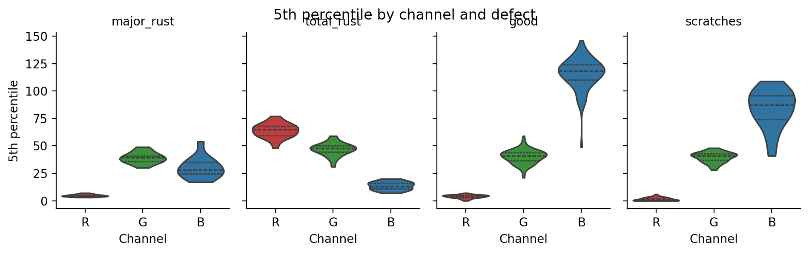

The std of the red and blue channels provide similar predictive power.

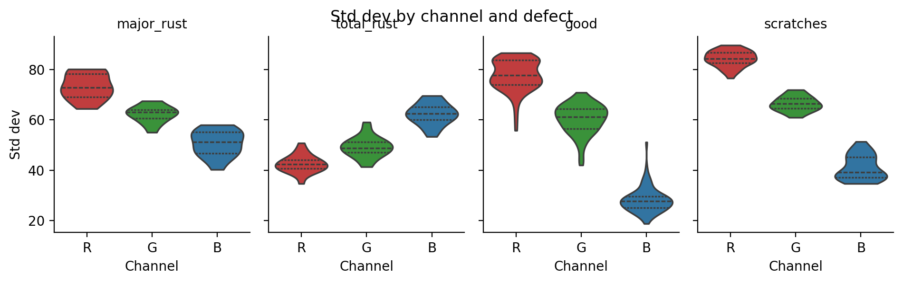

<details>
<summary>Violin plots for the remaining statistics</summary>

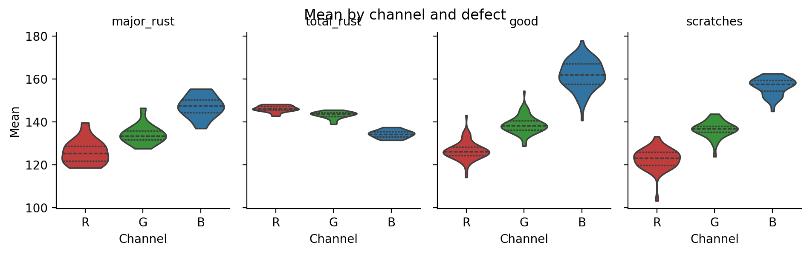
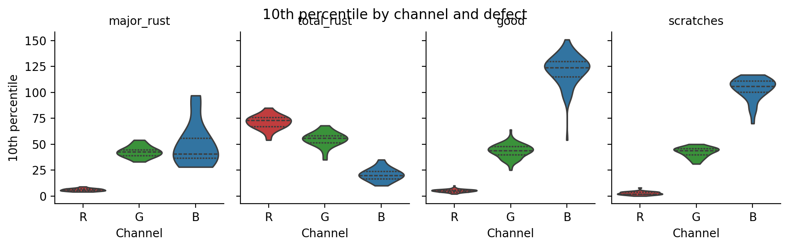
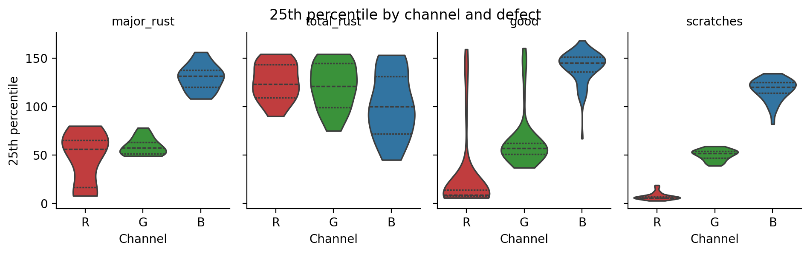
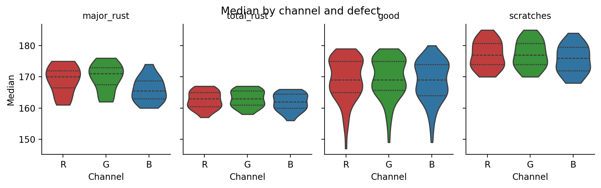
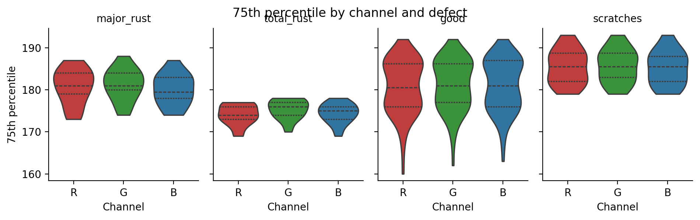
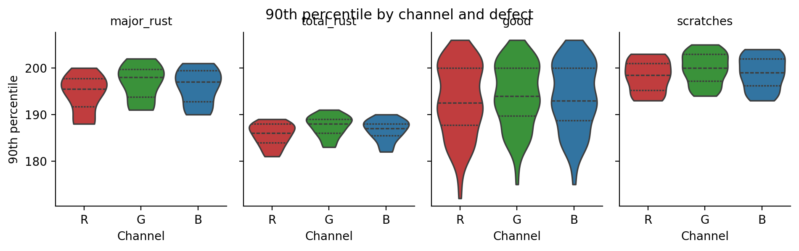
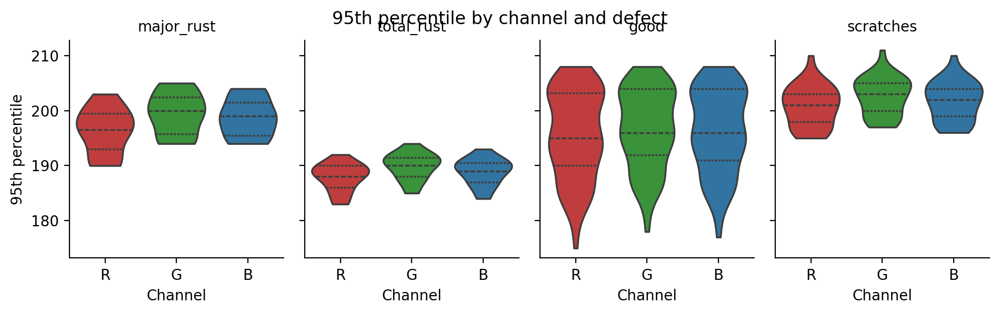

</details>

The EDA script saves these labels and features in a CSV file. This combines the training and testing data, so we need to stratify and re-split later.

## Model Training, Hyper-parameter Tuning, and Cross Validation

Given the relationships discussed above, a decision tree model is a natural place to begin the classification task. We can perform a grid search to optimize the tree's parameters (`depth`, `min_samples_leaf`). And since the dataset is small, we can perform a 5-fold cross validation to ensure the model generalizes well.

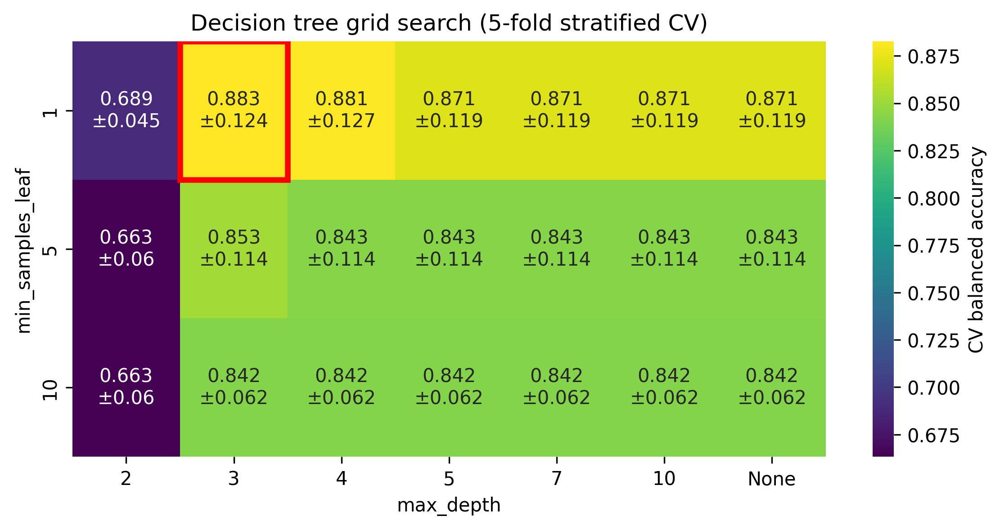

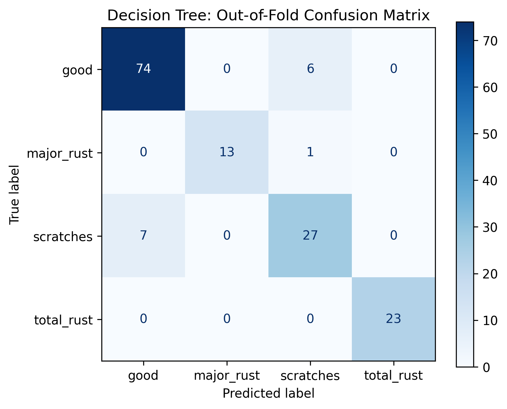

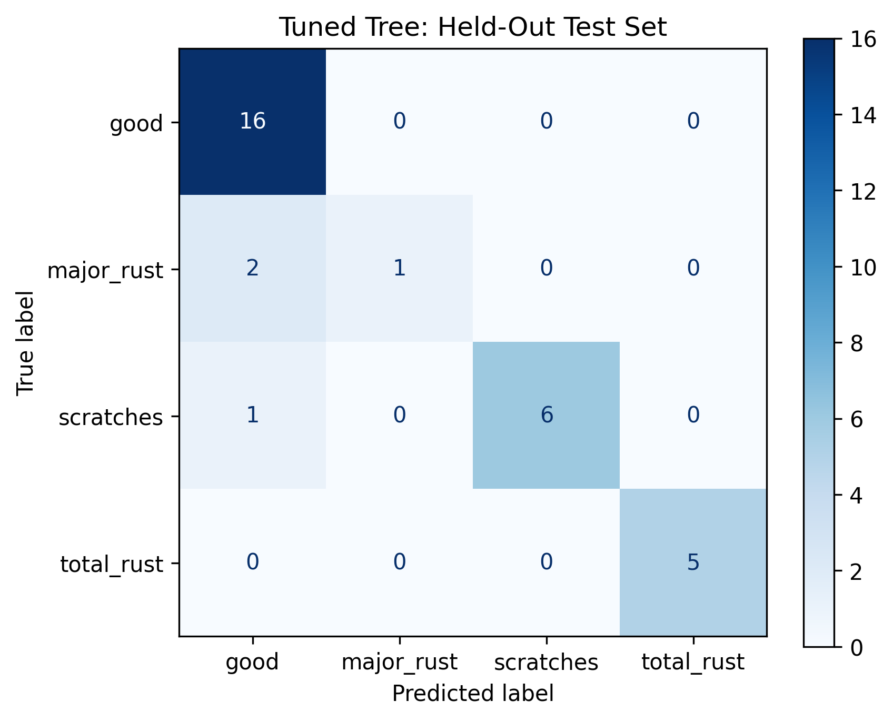

Training an SVM yields very similar results.

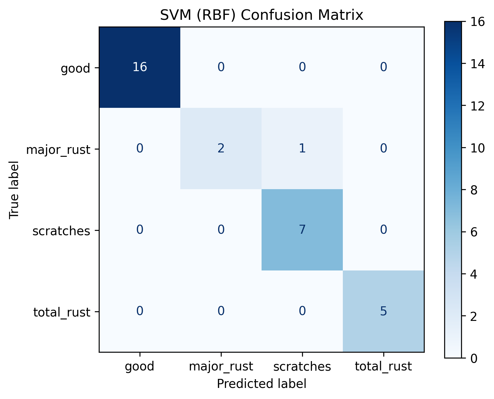

## PatchCore Comparison

For comparison, I also trained PatchCore (via `anomalib`, with a `wide_resnet50_2` backbone). Unlike the classifiers above, PatchCore is trained only on `good` images and flags anything that strays too far from them as a defect, so it only answers good vs. defect and does not name the defect class.

`python -m metal_plate.train_patchcore` runs a grid search over three hyper-parameters:

- `layers`: which backbone feature maps make up the patch embeddings: `layer2`, `layer3`, or `layer2+layer3` (the PatchCore default).
- `coreset_sampling_ratio`: the fraction of training patches kept in the memory bank: `0.01` (paper default), `0.1`, `0.25`, `0.5`.
- `num_neighbors`: how many nearest memory-bank patches are used when scoring a test patch: `1`, `3`, `5`, `9`, `15`.

`num_neighbors` only matters at inference, so each `layers`/`coreset_sampling_ratio` pair is fit once and then evaluated at every `num_neighbors` value. That gives 60 configurations from 12 fits. Configurations are ranked by image-level AUROC, with image-level F1 breaking ties. Every result goes to `metal_plate/patchcore_grid.csv`. The best checkpoint and its settings go to `metal_plate/best_model/`.

The task is easy for PatchCore. AUROC is at or near 1.0 in every configuration, so the configurations are really separated by F1. That score shows how well the default anomaly threshold works. `layer2` and `layer2+layer3` with a coreset ratio of at least `0.1` reach perfect F1 at most `num_neighbors` values. `num_neighbors=3` is consistently the weakest setting, dropping as low as 0.69 F1. The selected model is `layer2`, `coreset_sampling_ratio=0.1`, `num_neighbors=5` (`metal_plate/best_model/best_config.json`). It has perfect AUROC and F1.

The confusion matrix below comes from this best model. `python -m metal_plate.plot_patchcore` reloads the saved checkpoint and its config and runs prediction on the test set:

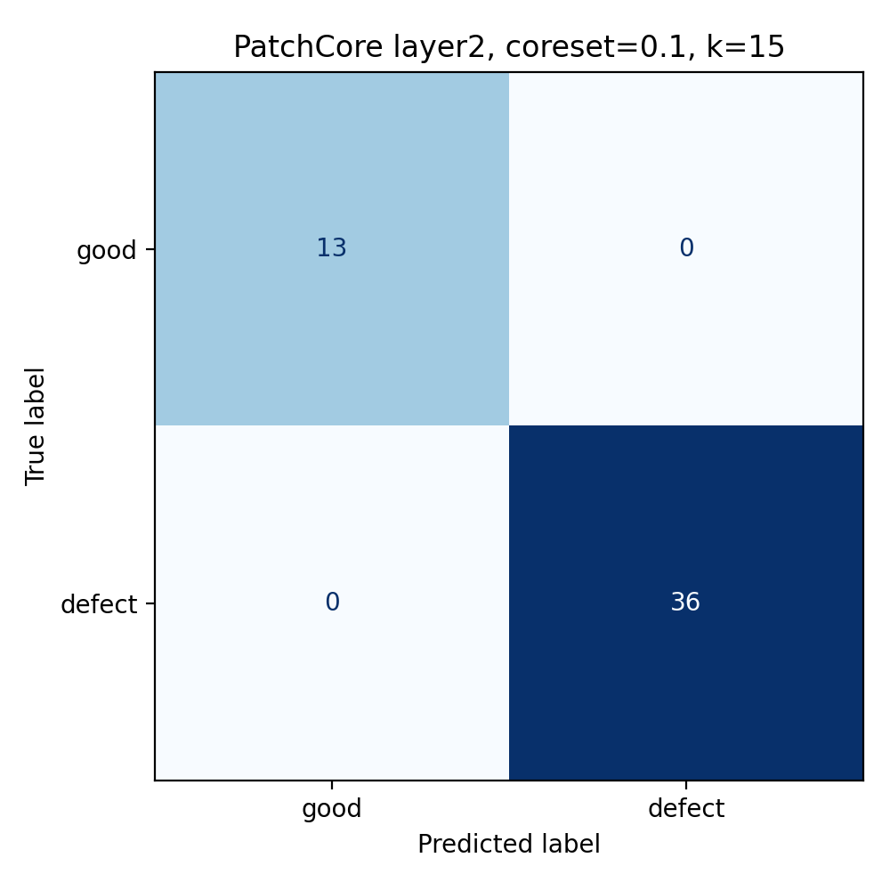

Note that this confusion matrix comes from the same test data that was used to choose the configuration in the grid search, so it is not an unbiased estimate of performance on new data, and it is somewhat optimistic. The effect is likely small here: nearly every configuration reaches an AUROC of about 1.0, and the EDA above shows that this category is easy to separate. A cleaner evaluation would rank configurations on one part of the test images and report the confusion matrix on a separate part that was never used for selection.

# `bracket_black`

## EDA / Pre-Processing

Performing the same style of EDA as for `metal_plate` does not yield the same simple separability. This is to be expected because the defects are much smaller. This indicates that we will not be able to simply vectorize the dataset into a csv like we did for `metal_plate`.

## PatchCore

The PatchCore approach here is the same as the [PatchCore comparison for `metal_plate`](#patchcore-comparison). Both datasets use the shared `patchcore/` package, and `bracket_black/datamodule.py`, `train_patchcore.py`, and `plot_patchcore.py` differ from their `metal_plate` versions only in the dataset name.

The only real difference is the outcome. The defects here are small, so the task is much harder than `metal_plate`, and no configuration reaches perfect scores. AUROC ranges from about 0.65 to 0.94. Using `layer3` alone is clearly the weakest choice, especially at a coreset ratio of `0.01`. Including `layer2` (alone or with `layer3`) does best, which fits the idea that the higher-resolution features are better at catching small, local defects. The selected model is `layer2+layer3`, `coreset_sampling_ratio=0.25`, `num_neighbors=1` (`bracket_black/best_model/best_config.json`), with an AUROC of 0.943 and an F1 of 0.868. Several `layer2+layer3` configurations tie on AUROC, so F1 decides between them.

## Results

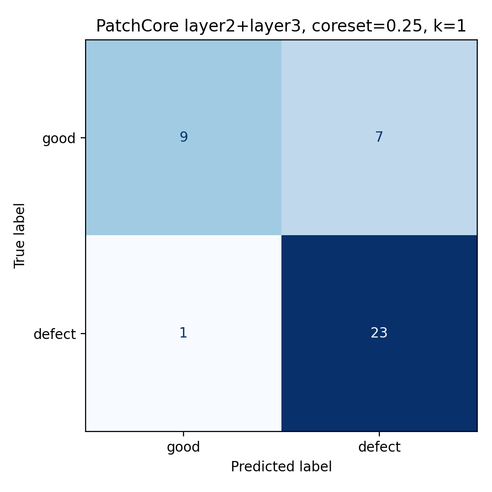
